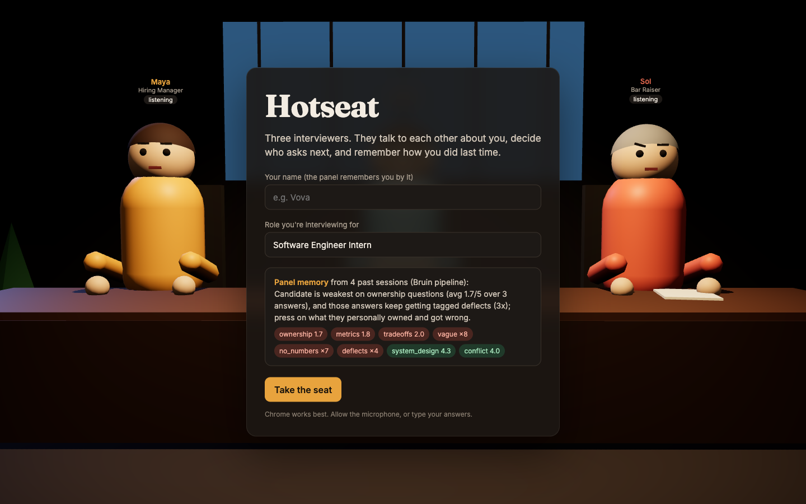
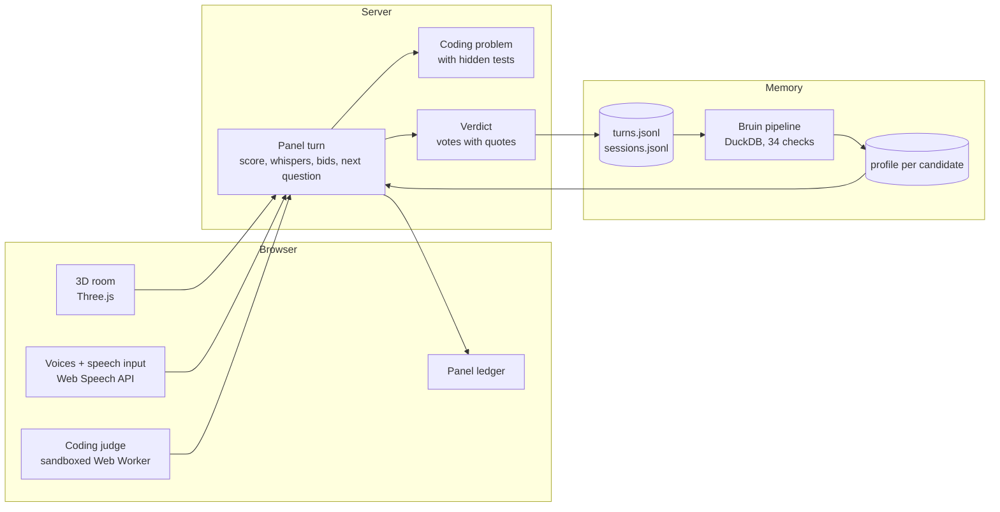
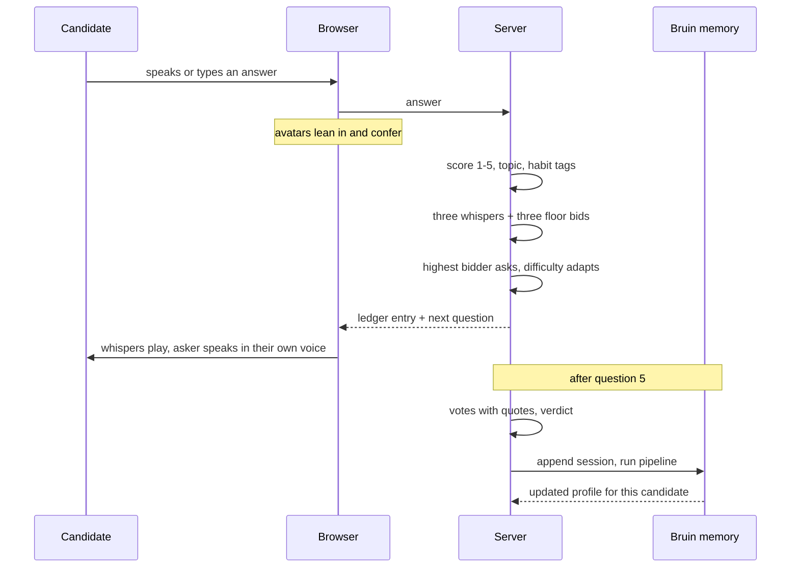

<div align="center">


# Hotseat

**An interview panel that argues about you and remembers you.** Three AI interviewers sit across a 3D table. After
every answer they **score it, whisper about you in character, and bid for the next question**. The panel raises the
difficulty when you're strong and presses where you're weak. Question 3 is a **live coding round with hidden tests**.
At the end each interviewer **votes with a quote from your own answers**. A **Bruin pipeline** turns every session
into a **memory profile**, so the next panel opens on your known weak spots.

<br/>


<br/>



<br/>

</div>

---

**Hackathon:** Multiplayer AI Hackathon at AWS Builder Loft<br/>
**Track:** 3, Grow with Agents<br/>
**Built:** November 23, 2026<br/>
**Team:** Volodymyr Borysenko<br/>
**Required tool:** Bruin (the panel's memory)

| Where | What you'll find |
|------|------------------|
| `server.js` | The panel: scoring, whispers, floor bids, coding problems, verdict, Bruin trigger |
| `src/main.js` | The 3D room, the three avatars, voices, speech input, ledger, in-browser judge |
| `bruin/` | The memory pipeline: 7 DuckDB assets, 34 quality checks |

---

## The Problem

Most interview practice is one chatbot reading questions off a list. Real interviews are not like that. A panel is
several people with different goals. They react to what you just said and talk about you between questions. They
push harder when you dodge. Then they decide together, and they cite what you said.

Practice tools also forget you. You give the same vague, number-free answer in five mock interviews in a row, and
nothing presses you on it, because every session starts from zero.

Hotseat fixes both. Three agents with their own goals run the interview as a panel, and a Bruin pipeline gives them a
memory of you that carries from one session to the next.

---

## Meet the Panel

| Interviewer | Role | Wants | Bids high when |
|---|---|---|---|
| **Maya** | Hiring Manager | Ownership and impact | Your personal role is vague ("we improved stuff") |
| **Theo** | Tech Lead | Depth and tradeoffs, runs the coding round | An answer has no tradeoff or technical detail |
| **Sol** | Bar Raiser | Proof | A claim has no numbers or can't be checked |

Each has their own look, their own voice, and their own reactions on screen: heads turn to whoever speaks, Maya nods
when impressed, Sol tilts their head when skeptical, and all three lean in to confer while they decide.

---

## Architecture at a Glance



### One turn



---

## How It Works

1. **Sit down.** Enter your name and the role. If the panel has met you before, the start screen shows your Bruin
   memory: weakest topics, repeated habits, strongest topics.
2. **Answer.** Speak (Chrome speech recognition) or type. While the server thinks, the three avatars lean in and
   confer.
3. **The panel decides, in the open.** One structured call returns:
   - a **score** for your answer, its **topic** and **habit tags** (`no_numbers`, `vague`, `we_not_i`, `strong_example`...)
   - three in-character **whispers**, one per interviewer
   - a **floor bid** from each interviewer, driven by their own goal
   - the **decision**: who asks next, why, and at what difficulty

   All of it goes into the **Panel ledger**, so you can see what the agents decided and why.
4. **Live coding round.** On question 3 Theo generates a problem at your level (difficulty follows your average so
   far) with 6 hidden tests. You write **Python** (the default) or JavaScript. Python runs in the browser through
   **Pyodide** (CPython compiled to WebAssembly), JavaScript in a plain Web Worker. Both are sandboxed with a timeout,
   so an infinite loop can't freeze the page, and both run the exact same hidden tests. Your code and the judge's report go to the panel like any
   other answer.
5. **Verdict.** Each interviewer votes hire or no hire with one reason and an **exact quote** from your answers.
   You get the panel verdict, strengths, growth areas each with evidence and a practice drill, and Maya says the
   verdict out loud.
6. **Memory.** The session is appended to the log and the Bruin pipeline runs. Next time you sit down under the same
   name, the panel reads your profile and opens on your weak spots. It also notices when you fix an old habit.

---

## Memory with Bruin

Bruin is not a side integration here. It is the reason the panel can remember you.

| Asset | What it does |
|---|---|
| `raw.turns` | Loads every answered question from `data/turns.jsonl` |
| `raw.sessions` | Loads every verdict from `data/sessions.jsonl`, latest row per session |
| `mart.topic_stats` | Average score per candidate and topic |
| `mart.tag_counts` | Habit tags on weak answers (score 3 or below) per candidate |
| `mart.session_trend` | Overall score and verdict per session, in time order |
| `mart.profile` | One row per candidate: weak and strong topics, weak habits, trend, focus sentence |
| `export.profile_json` | Writes the profiles out; `run.sh` swaps the file in atomically |

**34 quality checks** run on every pipeline run: asker must be one of the three interviewers, scores between 1 and 5,
verdicts from the allowed set, no duplicate turns in a session, one profile row per candidate, and every candidate with
turns has a profile. If any check fails, the old profile stays and the panel keeps working.

The focus sentence is built in SQL, not by a model, so the memory is reproducible. A real one from testing:

> Candidate is weakest on ownership questions (avg 1.7/5 over 3 answers), and those answers keep getting tagged
> deflects (3x); press on what they personally owned and got wrong.

The full pipeline runs in **under half a second** after each interview.

---

## Why We Built It This Way

**One structured call per turn.** Scoring, three whispers, three bids and the next question come back from a single
call with a strict schema. A turn takes about 5 to 6 seconds, and the avatars confer on screen while they wait, so
the pause reads as deliberation rather than loading.

**Bids make the panel a panel.** Each interviewer has a goal and a trigger. Letting them bid for the floor, and
showing the bids, turns "who asks next" into a decision you can watch instead of a fixed rotation.

**Evidence or it didn't happen.** Every vote must quote the candidate exactly. Feedback you can check is feedback you
can act on.

**The judge runs in the browser.** Hidden tests run in a Web Worker with a hard timeout, Python through Pyodide. No code execution server, no
setup, and nothing the candidate writes touches the backend.

**Memory in a pipeline, not a prompt.** Past sessions go through Bruin into DuckDB with quality checks, and the agents
read a small checked profile. The memory stays the same size no matter how many sessions you run, and bad data
can't reach the panel.

**One profile per candidate.** Anyone can sit down. A new name gets a fresh panel; your name gets your history.

---

## Results From Testing

A scripted end-to-end run through the real API, answering weakly on purpose. These are the panel's own words:

| Answer | Score | Topic | One whisper |
|---|---|---|---|
| "I built a hospital bill checker... we improved stuff a lot" | 1 | metrics | Sol: "Fifth metrics answer with zero numbers. Same no_numbers habit as past sessions, not fixed." |
| An empty function, 4 of 6 hidden tests | 2 | debugging | Theo: "Function x with an empty body, no edge case talk. Empty input failed. I doubt depth here." |
| "I added caching and cut cold reads from 10 seconds to under 5. I owned the change end to end." | 3 | metrics | Maya: "Finally an 'I owned it end to end' answer; ownership habit is improving." |
| "We benchmarked both and picked Postgres since it was 2x cheaper" | 2 | tradeoffs | Theo: "I asked about cache invalidation and got Postgres versus vector DB. Zero answer on staleness." |

Verdict: **no hire, 1.8/5**, three votes each with a quote. Bruin updated the profile in 0.3 seconds, and the focus
for the next session moved from metrics to ownership, because that is where the answers got worse.

---

## Run It

```bash
npm install
cp .env.example .env        # add ANTHROPIC_API_KEY
npm run dev                 # API on :8787, app on http://localhost:5173
```

Bruin: put the `bruin` binary in `.tools/bruin`, on your PATH, or set `BRUIN_BIN`. Run the pipeline by hand with
`bruin/run.sh`.

Use Chrome for speech input. Typing works in every browser.

---

## Code Map

| Path | What |
|------|------|
| `server.js` | Panel turn, coding problem, verdict, per-candidate memory, Bruin queue |
| `src/main.js` | Scene, avatars, animation, voices, speech input, ledger, coding judge, verdict screen |
| `public/py-worker.js` | Python judge: Pyodide in a Web Worker, runs the hidden tests |
| `src/style.css`, `index.html` | The UI |
| `bruin/run.sh` | Runs the pipeline and swaps in the new profile |
| `bruin/hotseat/assets/` | The 7 SQL assets and their checks |
| `bruin/.bruin.yml` | DuckDB connection |

---

## Limits

- Speech recognition and voices come from the browser, so they sound best in Chrome on macOS.
- The coding round supports Python and JavaScript. Python loads Pyodide from a CDN the first time, about a second.
- Candidates are identified by the name they type. That is fine for practice, not for anything private.
- The panel's scores are one model's judgment. The quotes keep them checkable, but they are not a real hiring
  decision.
