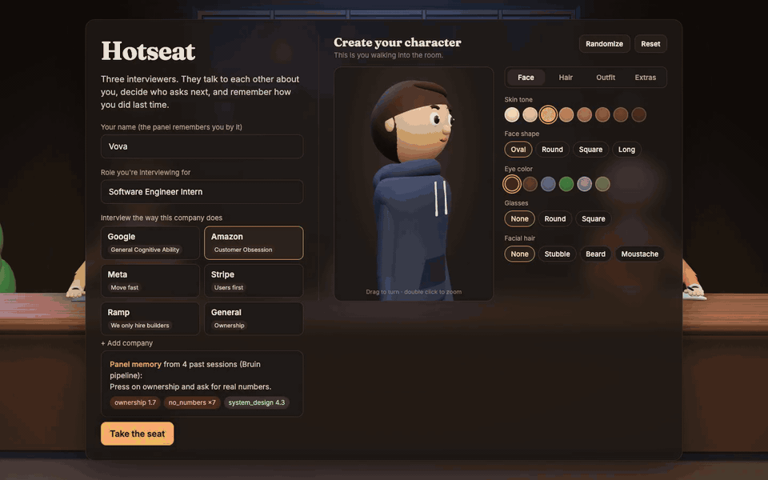
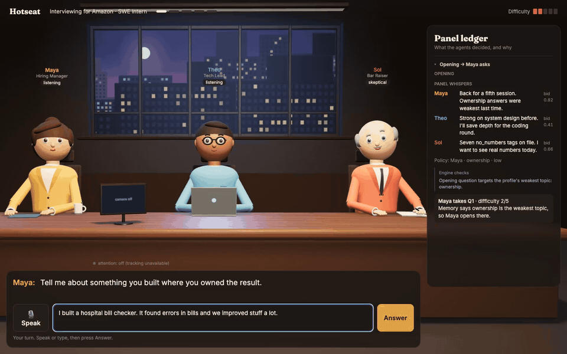
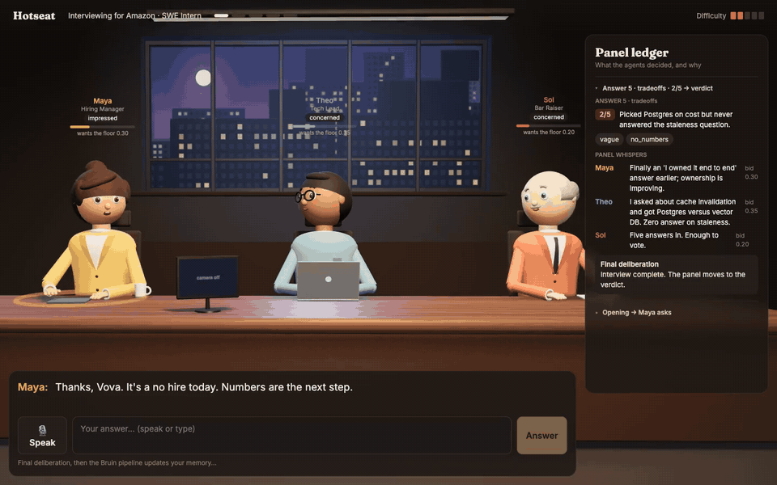
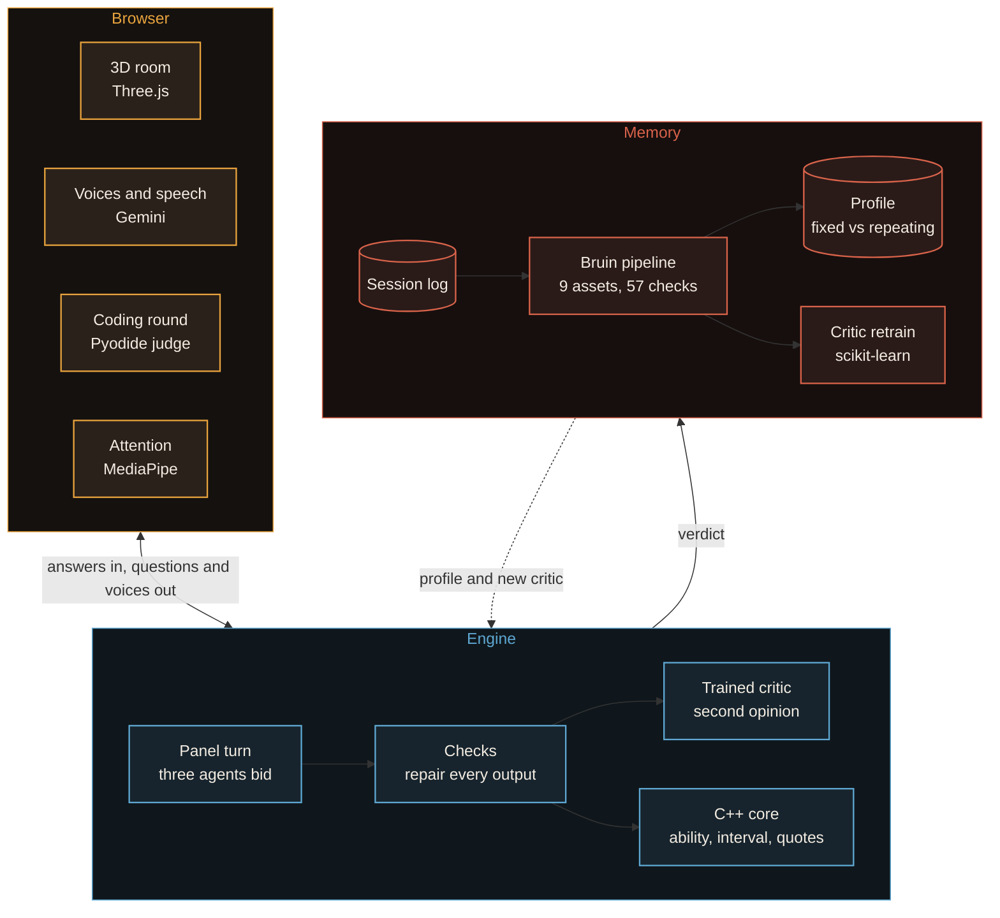
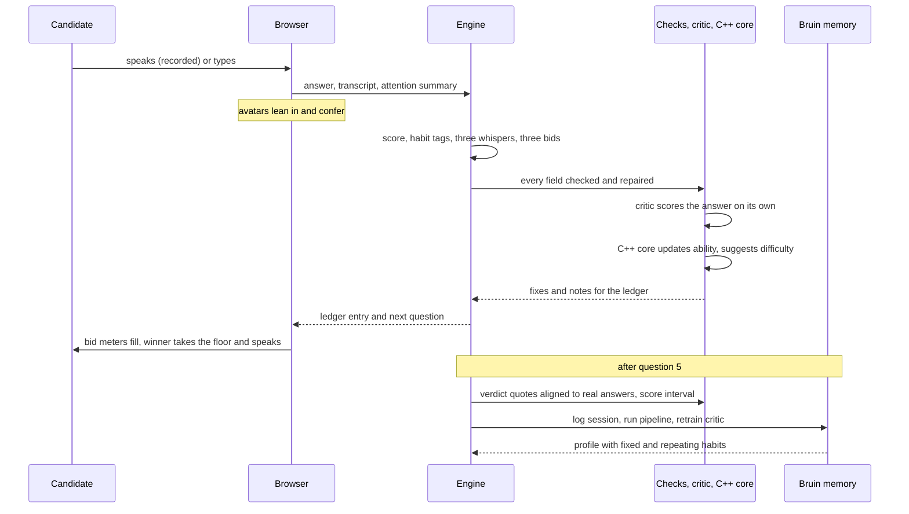
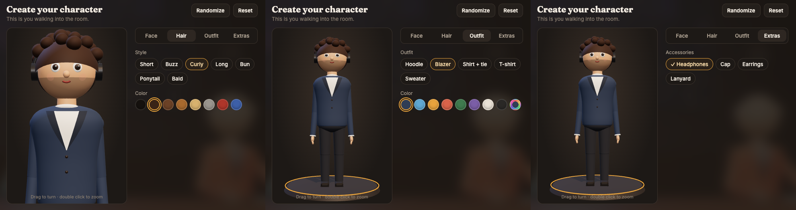
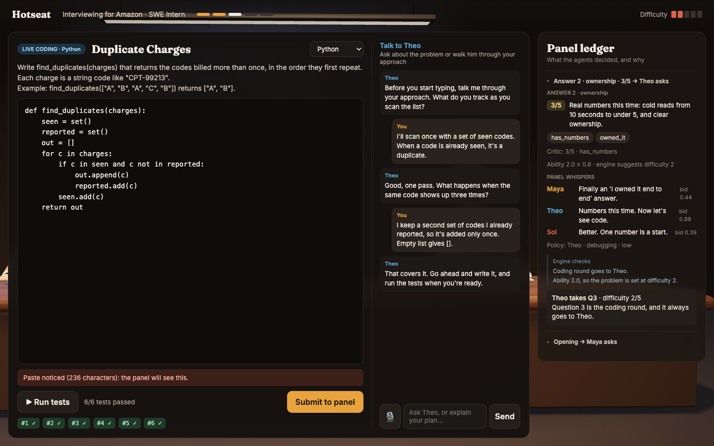
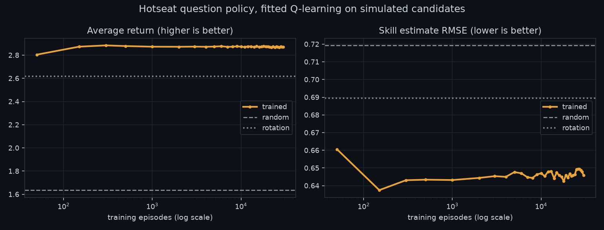

<div align="center">


# Hotseat

**An interview panel that argues about you and remembers you.** You walk through a door into a 3D room where three
AI interviewers wait at a table. After every answer they **score it, whisper about you in character, and bid for the
next question**, each in their own voice. A **C++ engine** estimates your ability and sets the next difficulty.
Question 3 is a **live coding round** where you talk your approach through with the Tech Lead while hidden tests judge
your code. At the end each interviewer **votes with a quote from your own answers**, every quote checked against what
you really said. A **Bruin pipeline** and a **model we trained** learn from each session, so the next panel knows
which habits you fixed and which ones you keep repeating.

<br/>


<br/>


<br/>

</div>

---

**Hackathon:** Multiplayer AI Hackathon at AWS Builder Loft<br/>
**Track:** 3, Grow with Agents<br/>
**Built:** November 23, 2026<br/>
**Team:** Volodymyr Borysenko<br/>
**Required tool:** Bruin (the panel's memory)

| Where | What you'll find |
|------|------------------|
| [Live demo](https://hotseat-swart.vercel.app) | The full interview in your browser (memory runs on a local install) |
| `engine/` | The interview engine: panel, checks, trained critic, C++ core, coding chat, voices, transcription |
| `src/` | The 3D room, voices, speech input, coding round, attention tracking, ledger, score card |
| `bruin/` | The memory pipeline: 9 DuckDB assets, 57 quality checks |
| `native/` | The C++ core and its WebAssembly build |
| `train/` | The answer critic's trainer and data |

---

## See It Move

[](docs/entrance.mp4)

You walk down the hallway and open the door. The panel looks up and Maya waves. [Full video (MP4)](docs/entrance.mp4).

[](docs/deliberation.mp4)

After each answer the panel whispers about you and bids for the floor. Sol bids highest, so he asks next. The ledger
shows why. [Full video (MP4)](docs/deliberation.mp4).

[](docs/exit.mp4)

Maya reads the verdict and you walk out. The frame freezes on your score card. Every vote quotes your own words.
[Full video (MP4)](docs/exit.mp4).

---

## The Problem

Most interview practice is one chatbot reading questions off a list. Real interviews are not like that. A panel is
several people with different goals. They react to what you just said and talk about you between questions. They
push harder when you dodge. Then they decide together, and they cite what you said.

Practice tools also forget you. You give the same vague, number-free answer in five mock interviews in a row, and
nothing presses you on it, because every session starts from zero.

Hotseat fixes both. Three agents with their own goals run the interview as a panel, and a Bruin pipeline gives them a
memory of you that carries from one session to the next.

---

## Meet the Panel

| Interviewer | Role | Wants | Bids high when |
|---|---|---|---|
| **Maya** | Hiring Manager | Ownership and impact | Your personal role is vague ("we improved stuff") |
| **Theo** | Tech Lead | Depth and tradeoffs, runs the coding round | An answer has no tradeoff or technical detail |
| **Sol** | Bar Raiser | Proof | A claim has no numbers or can't be checked |

Each has their own look, their own voice, and their own reactions on screen: heads turn to whoever speaks, Maya nods
when impressed, Sol tilts their head when skeptical, and all three lean in to confer while they decide.

### Company Mode

Before you sit down you can pick a company: Google, Amazon, Meta, Stripe, Ramp, or a general panel. Each one is a
small file in `data/companies/`, researched from the company's own careers and interview prep pages plus a few
reputable write-ups (sources are listed in each file). It holds the company's stated values, its loop, its coding
style, its rubric terms and how each of our three interviewers adapts. At Amazon, for example, Sol acts as the Bar
Raiser for real and maps every answer to a Leadership Principle. The panel probes those values, the coding problem
follows the company's style, and the verdict rates you on each value with a quote from your answers.

---

## Architecture at a Glance



### One turn



---

## How It Works

1. **Walk in.** Enter your name and the role, then the camera walks you down a hallway, through the door and into your
   seat while the panel looks up. If they've met you before, the start screen shows your Bruin memory: weakest topics,
   repeated habits, strongest topics. Your webcam appears as a small self view.

   

2. **Answer.** Click Speak and talk, or type. Your answer is recorded and transcribed accurately, with the browser's
   live text only as a preview. The panel stops talking the moment you start. While the engine thinks, the three
   avatars lean in and confer. Each interviewer speaks in their own voice, one at a time.
3. **The panel decides, in the open.** One structured call returns:
   - a **score** for your answer, its **topic** and **habit tags** (`no_numbers`, `vague`, `we_not_i`, `strong_example`...)
   - three in-character **whispers**, one per interviewer
   - a **floor bid** from each interviewer, driven by their own goal
   - the **decision**: who asks next, why, and at what difficulty

   All of it goes into the **Panel ledger**, so you can see what the agents decided and why.
4. **Live coding round.** On question 3 Theo generates a problem at your level (difficulty follows your average so
   far) with 6 hidden tests. You write **Python** (the default) or JavaScript. Python runs in the browser through
   **Pyodide** (CPython compiled to WebAssembly), JavaScript in a plain Web Worker. Both are sandboxed with a timeout,
   so an infinite loop can't freeze the page, and both run the exact same hidden tests. Your code and the judge's report go to the panel like any
   other answer.
   - **Talk it through.** A chat beside the editor lets you type or speak to Theo. He opens by asking for your approach,
     answers clarifying questions honestly, reacts to your plan, and gives a hint only when you ask or are stuck. He never
     writes the code. The whole talk-through goes to the panel with your submission.
   - **Integrity.** The editor counts typed and pasted characters, the largest single paste, test runs and time to
     submit. A large paste shows a note in the editor, the panel sees a summary, and Theo asks you to walk him through
     the part you pasted.
   - If your function prints its answer or returns `None`, the judge says so instead of just failing the tests.

   

5. **Verdict.** Each interviewer votes hire or no hire with one reason and an **exact quote** from your answers.
   Maya says the verdict out loud, then you stand up and walk out, and the frame freezes on a score card: the verdict,
   the score with its 95% interval, three vote cards, and folding sections for strengths, what to work on (each with
   your words and a practice drill), engine checks, attention, and your trend. "Come back in" walks you through the
   door again.
6. **Memory.** The session is appended to the log and the Bruin pipeline runs. Next time you sit down under the same
   name, the panel reads your profile and opens on your weak spots. It also notices when you fix an old habit.

---

## The Engine

Every model output passes through `engine/checks.js` before you see it. Each check repairs what it can and leaves a
short note in the ledger, so you can see where the engine stepped in.

| Check | What it does |
|---|---|
| Coding tests | Runs a hidden reference solution on every generated test and drops any test it disagrees with. Two failed problems in a row fall back to a verified backup problem |
| Real quotes | Any verdict quote you never said is replaced with your closest real words, found by the C++ aligner |
| Votes and verdict | One vote per interviewer; a verdict can't contradict a unanimous vote; the score stays in range |
| Floor rules | One whisper per interviewer, nobody asks three times in a row, the coding round always goes to Theo |
| Score sanity | A 5 with a "no numbers" tag, or a 1 with only strong tags, is pulled back to 3 |
| Habit vocabulary | Synonym tags map onto one set, so memory counts "lacks metrics" and "no numbers" as the same habit |
| Repeats and coverage | Flags a question that repeats an earlier one, and nudges the panel toward topics not yet covered |
| Spoken text | Strips formatting and trims long questions at a sentence boundary |

## C++ Core

`native/hotseat_core.cpp` is compiled to WebAssembly (11.8 KB, no imports) with the WASI SDK and runs inside the
server, locally and on Vercel. A pure JS port gives identical results when WebAssembly isn't available, and tests check
the two agree.

- **Ability.** An item response model (Rasch, Bayesian with a prior at 3) estimates your ability from each question's
  difficulty and your score, with its standard error. The next difficulty is where you'd succeed about 60% of the time.
  The panel sees "[ENGINE] Ability 2.4 ± 0.6. Recommended next difficulty 3." and its pick is kept within one level.
- **Confidence.** The overall score comes with a 95% interval from 5,000 bootstrap resamples of your answer scores,
  with a fixed seed so the same interview always gives the same interval.
- **Quote alignment.** Word level Smith-Waterman alignment finds the span of your answers that best matches a quote,
  which is how invented quotes get replaced with your real words.

## Attention

With your permission, MediaPipe's face landmarker watches the webcam about six times a second, entirely in the
browser. It tells looking at the screen from looking away, eyes closed, or gone. Any stretch over 5 seconds becomes an
event and a quiet note on screen. No video leaves your machine; only the numbers do. The panel sees one line per answer
("looked at the screen 82%; away 7 s once") and is told to mention long absences neutrally and weigh them lightly.

## Voices and Speech

Maya, Theo and Sol each have their own Gemini voice and speaking style, with OpenAI as a fallback and the browser's
voice as a last resort. Lines go through one queue, so two interviewers never talk over each other, and the next clip
downloads while the current one plays. Your answers are recorded and transcribed by Gemini, keeping numbers and
technical terms exact. Leaving the tab silences the panel and turns the microphone off.

---

## Memory with Bruin

Bruin is not a side integration here. It is the reason the panel can remember you.

| Asset | What it does |
|---|---|
| `raw.turns` | Loads every answered question from `data/turns.jsonl` |
| `raw.sessions` | Loads every verdict from `data/sessions.jsonl`, latest row per session |
| `mart.topic_stats` | Average score per candidate and topic |
| `mart.tag_counts` | Habit tags on weak answers (score 3 or below) per candidate |
| `mart.session_trend` | Overall score and verdict per session, in time order |
| `mart.profile` | One row per candidate: weak and strong topics, weak habits, trend, focus sentence |
| `export.profile_json` | Writes the profiles out; `run.sh` swaps the file in atomically |

**57 quality checks** run on every pipeline run: asker must be one of the three interviewers, scores between 1 and 5,
verdicts from the allowed set, no duplicate turns in a session, one profile row per candidate, and every candidate with
turns has a profile. If any check fails, the old profile stays and the panel keeps working.

The focus sentence is built in SQL, not by a model, so the memory is reproducible. A real one from testing:

> Candidate is weakest on ownership questions (avg 1.7/5 over 3 answers), and those answers keep getting tagged
> deflects (3x); press on what they personally owned and got wrong.

Two progress marts make the learning visible. `mart.habit_progress` compares each habit in the latest session with the
sessions before it and marks it fixed, repeating or new, and `mart.topic_progress` does the same for topic scores. The
panel hears "Fixed since last time: shallow. Still repeating: vague, no numbers" and is told to give credit for fixes out
loud and press hard on what keeps coming back.

The full pipeline runs in **under half a second** after each interview.

---

## Trained Critic

The panel's score is one LLM call. The **answer critic** is a small model we trained ourselves that scores every
answer on its own, as a second opinion. If the two are 2 or more points apart, the ledger says so: "Trained critic
scored this 4/5, panel gave 1/5. Flagged for review." The critic never overrides the panel. Its score shows quietly
in the ledger as "Critic: 3/5" with its top habit tags.

- **Data.** 299 labeled answers generated once with Claude (all seven topics, scores 1 to 5, the eight habit tags),
  plus every real answer in `data/turns.jsonl`, deduplicated.
- **Model.** TF-IDF over word unigrams and bigrams plus 12 hand-made features (numbers and percentages, "I" versus
  "we", length, hedge words, technical words, question marks, the coding judge's pass rate). Ridge regression for the
  score, one logistic regression per tag with a threshold tuned on out-of-fold F1.
- **Runs in Node.** The fit is exported as 208 KB of JSON and `engine/critic.js` reimplements the math. A test checks
  the JS predictions match Python's on saved examples.
- **It learns.** After each Bruin run, `bruin/run.sh` retrains the critic on the seed plus all logged turns (under a
  second), and the server picks up the new model file on the next answer, no restart.

Honest numbers. On a held-out 20% (64 answers) the score is off by 0.52 on average and within 1 point 92% of the
time; tag F1 is 0.84 for strong_example, 0.91 for we_not_i, 0.70 for vague, but weak for no_numbers (0.22) and
rambling (1 test example). The harder test: trained on generated answers only and scored against the 20 real session
answers, the error is 1.1 points and 75% land within 1. Real answers are shorter and the panel grades them in
context, which the critic can't see. That gap is exactly why it flags instead of overriding.

## Trained Agents

The critic learns to score. The panel also learns **who should ask what next**. Before every question except the
coding round, a policy trained with reinforcement learning picks an interviewer, a topic and a difficulty band, and the
engine adds one line to the panel's prompt: "[POLICY] Trained policy suggests: Sol asks about metrics at medium
difficulty (expected info gain 0.42)." The panel keeps the final say. The engine notes whether it followed ("Panel
followed the trained policy") or not ("Panel overrode the policy: chose Maya on ownership"), and the ledger shows the
pick quietly as "Policy: Sol · metrics · medium".

- **Simulator** (`train/sim.py`). Synthetic candidates with a latent skill per topic (ownership, metrics, tradeoffs,
  system design, conflict, debugging, coding) on the C++ core's 1 to 5 scale. Skills share a general level and a
  people or technical cluster, about a third of candidates have one big weak spot, and habits such as no_numbers or
  deflects pull specific topics down. Answers are scored with the core's Rasch model plus noise. Each interviewer has
  a topic affinity: Sol's metrics questions and Theo's coding and design questions separate strong from weak answers
  more sharply than off-topic ones. Some candidates arrive with remembered weak topics, like a Bruin profile.
- **Belief.** A Gaussian over all seven skills, updated after every answer with the core's likelihood. A good coding
  answer also moves the belief about system design a little, through the correlations.
- **Reward.** Drop in total posterior variance (information gained about the candidate), plus 0.25 the first time a
  remembered weak topic is probed, minus 0.3 for repeating a topic and 0.1 when the same interviewer asks twice in a
  row.
- **Algorithm.** Q-learning with a linear Q over 32 features (one-step expected gain, the topic's uncertainty,
  coverage, memory, asker affinity, ability and SE from the core, questions left), fit in batches (fitted
  Q-iteration) on 30,000 seeded episodes, about 40 seconds on a laptop. Plain online Q-learning and Monte Carlo targets were tried first and stayed
  below a one-step greedy baseline; the batch fit fixed that. One thing it learned on its own: don't hand Theo the
  question right before the coding round, since he runs that round anyway (weight -0.13 on that feature).
- **Runs in Node.** Weights export to `engine/policy-model.json` (a few KB). `engine/policy.js` copies the belief
  update and the features, a test checks its Q values match Python's on saved states, and the server picks up a new
  file without a restart.

Results on 2,000 held-out **simulated** candidates (same candidates and random streams for every policy):

| Policy | Avg return | Skill RMSE | Weak topic probed |
|---|---|---|---|
| Trained (Q-learning) | **2.84** | **0.626** | 99.7% |
| One-step greedy on expected gain | 2.79 | 0.626 | 87.6% |
| Fixed rotation (Maya, Sol, Theo, ...) | 2.61 | 0.650 | 86.8% |
| Random | 1.63 | 0.691 | 74.6% |
| No questions (population average) | | 0.878 | |



Read it honestly. These are simulated candidates, so the numbers say the policy is good at the simulator, not at real
people. Five questions can't pin down seven skills, so the error only drops from 0.88 to 0.63. Against the one-step
greedy baseline the trained policy ties on skill error; its extra return comes from probing remembered weak topics
and not repeating itself. Most of the learning happens in the first few hundred episodes, because the features already
carry the one-step math.

**What learns from real sessions.** Every logged turn in `data/turns.jsonl` is replayed through the same belief and
turned into Q-learning transitions, and after each Bruin run `train/policy.py --quick` refits on them (plus 1,500 fresh
simulated episodes), anchored to the current weights, in about a second. There are 25 real turns from 5 sessions so
far (23 transitions), and none logged the difficulty they were asked at, so the medium band is assumed for them. New
sessions log difficulty. With this little data the update moves the weights by about 0.06 and the policy's held-out
simulated return by less than 0.01, which is the point: real sessions nudge it, they don't rewrite it yet.

## Why Hotseat Wins

| | Hotseat | Final Round AI | Yoodli | Google Interview Warmup | interviewing.io | LeetCode, HackerRank |
|---|---|---|---|---|---|---|
| Several interviewers who deliberate in the open | ✓ | | | | | |
| You can see why each question was chosen | ✓ | | | | | |
| Difficulty adapts with a measured ability estimate | ✓ | | | | | |
| Coding with hidden tests | ✓ | | | | ✓ | ✓ |
| Talk through your code with an interviewer | ✓ | | | | ✓ | |
| Spoken conversation | ✓ | ✓ | ✓ | ✓ | ✓ | |
| Feedback quotes your exact words, checked | ✓ | | | | | |
| Remembers which habits you fixed and which you repeat | ✓ | | | | | |
| Open source | ✓ | | | | | |

Based on public product pages, November 2026. A blank means we couldn't confirm the feature, not that it's missing.
interviewing.io's interviews are run by people. The rest are products we haven't tested ourselves.

---

## Why We Built It This Way

**One structured call per turn.** Scoring, three whispers, three bids and the next question come back from a single
call with a strict schema. A turn takes about 5 to 6 seconds, and the avatars confer on screen while they wait, so
the pause reads as deliberation rather than loading.

**Bids make the panel a panel.** Each interviewer has a goal and a trigger. Letting them bid for the floor, and
showing the bids, turns "who asks next" into a decision you can watch instead of a fixed rotation.

**Evidence or it didn't happen.** Every vote must quote the candidate exactly. Feedback you can check is feedback you
can act on.

**The judge runs in the browser.** Hidden tests run in a Web Worker with a hard timeout, Python through Pyodide. No code execution server, no
setup, and nothing the candidate writes touches the backend.

**Memory in a pipeline, not a prompt.** Past sessions go through Bruin into DuckDB with quality checks, and the agents
read a small checked profile. The memory stays the same size no matter how many sessions you run, and bad data
can't reach the panel.

**One profile per candidate.** Anyone can sit down. A new name gets a fresh panel; your name gets your history.

---

## Results From Testing

A scripted end-to-end run through the real API, answering weakly on purpose. These are the panel's own words:

| Answer | Score | Topic | One whisper |
|---|---|---|---|
| "I built a hospital bill checker... we improved stuff a lot" | 1 | metrics | Sol: "Fifth metrics answer with zero numbers. Same no_numbers habit as past sessions, not fixed." |
| An empty function, 4 of 6 hidden tests | 2 | debugging | Theo: "Function x with an empty body, no edge case talk. Empty input failed. I doubt depth here." |
| "I added caching and cut cold reads from 10 seconds to under 5. I owned the change end to end." | 3 | metrics | Maya: "Finally an 'I owned it end to end' answer; ownership habit is improving." |
| "We benchmarked both and picked Postgres since it was 2x cheaper" | 2 | tradeoffs | Theo: "I asked about cache invalidation and got Postgres versus vector DB. Zero answer on staleness." |

Verdict: **no hire, 1.8/5**, three votes each with a quote. Bruin updated the profile in 0.3 seconds, and the focus
for the next session moved from metrics to ownership, because that is where the answers got worse.

---

## Run It

```bash
npm install
cp .env.example .env        # ANTHROPIC_API_KEY, plus GEMINI_API_KEY for voices and transcription
npm run dev                 # API on :8787, app on http://localhost:5173
npm run check               # formatting, lint and 73 unit tests
```

- **Bruin:** put the `bruin` binary in `.tools/bruin`, on your PATH, or set `BRUIN_BIN`. Run the pipeline by hand
  with `bruin/run.sh`.
- **Critic retraining:** `uv venv .venv && uv pip install --python .venv/bin/python -r train/requirements.txt`.
  Without it the pipeline still runs and the critic keeps its last model.
- **C++ core:** the compiled `native/hotseat_core.wasm` is checked in. Rebuild with `npm run build:native` (needs the
  WASI SDK in `.tools/`).
- Chrome works best for the camera and microphone. Typing works everywhere.

---

## Code Map

| Path | What |
|------|------|
| `server.js` | HTTP routes only |
| `engine/panel.js` | Runs a turn: panel call, checks, critic, C++ core, coding problem, verdict, memory |
| `engine/checks.js` | Every repair and note the ledger shows |
| `engine/prompts.js`, `engine/schemas.js`, `engine/agents.js` | What each agent is told and the exact shape it must answer in |
| `engine/core.js`, `native/` | C++ core: WebAssembly loader, JS fallback, source and build script |
| `engine/critic.js`, `train/` | Trained critic: Node inference, Python trainer, data |
| `engine/policy.js`, `train/sim.py`, `train/policy.py` | Trained question policy: Node inference, simulator, Q-learning |
| `engine/coding.js` | Theo's coding chat and the integrity and talk-through text |
| `engine/tts.js`, `engine/stt.js` | Voices and transcription |
| `engine/memory.js` | Session log, profile, Bruin queue |
| `engine/companies.js`, `data/companies/` | Company mode: the researched playbooks and the prompt slice each call gets |
| `src/main.js` | Interview flow, ledger, score card |
| `src/scene.js` | Room, avatars, door entrance, exit, webcam |
| `src/voice.js`, `src/listen.js` | Voice queue and speech input |
| `src/coding.js`, `public/py-worker.js` | Coding round and the Python judge |
| `src/gaze.js` | Attention tracking |
| `src/company.js` | Company picker on the start card and the HUD label |
| `bruin/` | The 9 SQL assets, their checks and `run.sh` |
| `tests/` | Unit tests for checks, critic, question policy and C++ core |

---

## Limits

- The hosted demo runs the full interview but doesn't keep memory or retrain the critic. Run it locally for that.
- The question policy was trained on simulated candidates. Its numbers describe the simulator, and only 25 real turns
  have fed back into it so far.
- The critic is honest about its weak spots: it rarely catches answers without numbers (F1 0.22). It only flags,
  never overrides.
- Attention tracking needs a camera and works best in good light. It reports, it never accuses.
- Candidates are identified by the name they type. Fine for practice, not for anything private.
- The panel's scores are model judgments. The quotes and checks keep them honest, but they are not a real hiring
  decision.

## Company research with an Apify Actor

`actor/` is an Apify Actor, `hotseat-company-research`, built with Crawlee. It is deployed as
`enterprising_arboretum_iq2/hotseat-company-research`.

- What it scrapes: official careers pages only. Google, Amazon, Meta, Stripe and Ramp start from
  curated pages (how we hire, interview prep, leadership principles, values). A new company starts
  from its careers URL, or from `<name>.com/careers`, `/jobs` and `/about/values`, and follows
  same-site links about interviews, hiring, values and culture. CheerioCrawler first, robots.txt
  respected, 40 requests a minute at most. Pages that render in JS get one PlaywrightCrawler pass.
- Each page becomes `{company, url, title, headings, values_candidates, interview_text, fetched_at}`.
- "+ Add company" on the start screen calls `POST /api/companies/research`. The server runs the
  Actor on Apify when `APIFY_TOKEN` and `APIFY_ACTOR` are set, or the same crawl code in-process
  otherwise. One Claude call turns the pages into a profile in the `data/companies` shape, with
  sources set to the scraped URLs, and saves it.
- `npm run research:companies` re-checks the five built-in profiles against their official pages.
  It only adds confirming sources and fixes value spelling; everything else goes to
  `train/data/company_refresh.json` for a person to review.

Limits: `values_candidates` is a heuristic and picks up stray lines. Stripe's official pages
confirm almost nothing, and Ramp publishes no interview process. Interview loop details for new
companies mostly come from the model and are marked "(uncertain)". The hosted demo cannot run
the local crawl and cannot save new files, so there research needs the Apify token and lasts only
for that server instance.
